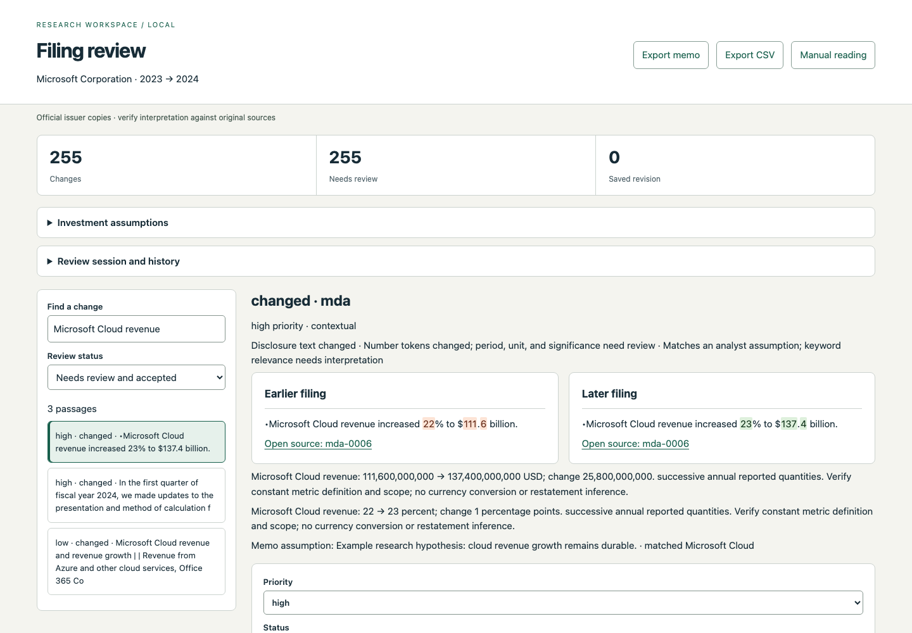

# Filing change tracker: cited Risk Factors and MD&A changes between consecutive 10-Ks

[](https://github.com/RahilBhavan/filing-tracker/actions/workflows/ci.yml) [](LICENSE)



Filing change tracker compares the Risk Factors (Item 1A) and MD&A (Item 7) sections of two annual 10-K filings from the same company. It aligns paragraphs across the two years, including two-paragraph splits and merges, flags numeric changes and links each change to analyst-written assumptions. A localhost review app saves decisions with a revision history and exports a cited memo and CSV. It uses the Python standard library only and calls no LLM or paid service.

Related projects: [filing-research-assistant](https://github.com/RahilBhavan/filing-research-assistant) answers questions about a filing with BM25 retrieval, and [financial-metrics-analyst](https://github.com/RahilBhavan/financial-metrics-analyst) computes financial metrics through an MCP server. This project instead compares two years of the same filing and shows what changed.

## Results

The study ran on 3 real filing pairs with 50 author labels: 46 changed decisions and 4 unchanged controls. Numbers come from the latest `python3 scripts/benchmark.py` run, recorded in [`docs/real-benchmark.json`](docs/real-benchmark.json) and summarized in [`docs/v2-results.md`](docs/v2-results.md).

| Pair | Labelled changes | V1 recovered | V2 recovered | Important changes in V2 top 10 |
| --- | ---: | ---: | ---: | ---: |
| Microsoft FY2022→2023 | 19 | 18 | 19 | 2/12 |
| Microsoft FY2023→2024 | 19 | 18 | 19 | 0/10 |
| Berkshire FY2023→2024 | 8 | 6 | 8 | 1/6 |
| Total | 46 | 42 | 46 | 3/28 |

- The September 22 revision (V2) recovered 46/46 sampled changed decisions, against 42/46 for V1. Including the unchanged controls, V2 matched 50/50 exact decisions and V1 matched 46/50.
- A correct detection needs the exact old and new block group and the change type. One Berkshire label was corrected from a standalone addition to a paragraph split after inspecting both originals. That correction is not an algorithm improvement.
- Ranking is weak. Only 3 of 28 labelled important changes appear in the three V2 top-ten lists, and 26 of the 30 top-ten entries have no label.
- V2 machine comparison took 1.23 s, 1.37 s and 3.41 s per pair in the recorded run. These times exclude human reading and do not show analyst time savings.

## How it works

1. `filing_tracker/source_formats.py` converts issuer DOCX and PDF originals into HTML blocks. Each block keeps its original locator (page and bounding box for PDF).
2. `filing_tracker/core.py` parses Item 1A and Item 7 into blocks and ranks each edit with visible rules.
3. `filing_tracker/alignment.py` matches blocks with subsection and neighbouring-text context. It handles reordered exact matches and two adjacent split or merged paragraphs, and it marks uncertain matches.
4. `filing_tracker/numbers.py` extracts narrative quantities with metric, unit and period. It reports absolute and percentage-point changes, and it abstains when units or periods are not comparable.
5. `filing_tracker/thesis.py` links changes to editable assumptions by keyword. It makes no support or contradiction claim.
6. `filing_tracker/review_app.py` serves the review app on loopback only. `filing_tracker/report.py` writes the memo, CSV, JSON and cited source snapshots.
7. `filing_tracker/benchmark.py` and `filing_tracker/evaluation.py` score V1 (`filing_tracker/baseline.py`) and V2 against the author labels.

## Run it

Prerequisites: Python 3.9 or later (CI runs 3.9 and 3.12). No third-party packages, API keys or environment variables. Poppler's `pdftotext` is needed only to regenerate the converted corpus. Node.js with Playwright is needed only for the optional browser check.

Run the tests and the verification script:

```sh
python3 -m unittest discover -s tests -q
python3 verify.py
python3 scripts/benchmark.py
```

On 2026-10-21 the suite ran 54 tests, all passing, on Python 3.14.7. `verify.py` runs the tests and four fictional-fixture commands and writes to untracked `build/`; `python3 verify.py --update` rewrites the tracked `demo/` and `verification.json`. `scripts/benchmark.py` also writes to `build/`; `--update` rewrites `docs/real-benchmark.json`, whose timings change on each run. The tests bind a localhost port, so a sandbox can need network permission.

Open the review app on the Microsoft FY2023→2024 pair:

```sh
python3 -m filing_tracker serve corpus/msft-2023-2024.json \
  --assumptions corpus/example-assumptions.json --out reviews/microsoft --port 8874
```

Open `http://127.0.0.1:8874` and select a passage. Save priorities, notes, dismissals or corrected matches. The example assumptions are hypotheses to replace with your own. To resume, restart with the same output directory. `review-state.json` holds the revision history and `report/` holds the exported memo and CSV. A saved review is tied to exact source hashes, so use one directory per pair.

Export a memo without the browser:

```sh
python3 -m filing_tracker compare corpus/msft-2023-2024.json \
  --assumptions corpus/example-assumptions.json --out demo/real-microsoft
python3 -m filing_tracker compare corpus/brk-2023-2024.json --out demo/real-berkshire
```

See the committed [Microsoft memo](demo/real-microsoft/memo.md). Every excerpt links to a local snapshot of the preserved DOCX or PDF.

Other commands:

- `python3 scripts/review_packet.py` writes the blank independent-review packets in `corpus/blind-review/`.
- `python3 scripts/session_summary.py reviews/microsoft/review-state.json` summarizes timed review sessions.
- `python3 scripts/prepare_corpus.py` regenerates `corpus/converted/` and needs `pdftotext`.
- `python3 -m filing_tracker fetch --help` shows the optional SEC EDGAR fetch. EDGAR returns HTTP 403 unless the request has a User-Agent with a name and email (`--user-agent`).

The optional browser check changes decisions and records sessions. Run it only against a disposable review server, never against a human measurement directory:

```sh
python3 -m filing_tracker serve fixtures/development-pair.json --out /tmp/filing-browser-check --port 8873
# In another terminal, with Playwright installed:
REVIEW_URL=http://127.0.0.1:8873 node scripts/browser-check.cjs
```

## Repository layout

- `filing_tracker/`: the package, CLI (`python3 -m filing_tracker`) and the static review app in `static/`.
- `corpus/`: original filings, converted text, pair manifests, author labels and blind-review packets.
- `fixtures/`: fictional Alder Components regression filings and gold labels.
- `demo/`: committed reports for the real and fictional pairs. CI fails if they drift.
- `docs/`: results, provenance, evaluation and the walkthrough.
- `scripts/`: benchmark, corpus preparation, review packets, session summary and browser check.
- `tests/`: unit tests.
- `verify.py` and `verification.json`: the verification script and its recorded output.
- `PLAN.md`: the V2 implementation plan and its final status.

## Documentation

The [documentation index](docs/README.md) lists every file. The main ones:

- [Current measured results](docs/v2-results.md): per-pair counts, ranking coverage and known limits.
- [Completion audit](docs/completion-audit.md): what was verified on September 22, 2026 and what remains open.
- [Source access and provenance](docs/source-access.md): filing URLs, accession numbers and conversion limits.
- [Walkthrough](docs/walkthrough.md): a step-by-step comparison and review correction on the fictional pairs.
- [Evaluation](docs/evaluation.md): where the current and historical evaluation records live.

## Sources

- Microsoft FY2022, FY2023 and FY2024 10-K filings as issuer DOCX files, and Berkshire Hathaway FY2023 and FY2024 10-K filings as issuer PDF files. All five were downloaded on September 21, 2026.
- These are official issuer copies, not byte-identical SEC HTML. The pair manifests (`corpus/*.json`) record the source URL, SEC accession number, filing index URL and SHA-256 hashes of the original and converted files. Comparison checks both hashes on load.
- The fictional Alder Components filings in `fixtures/` are author-written regression data, not real filings.

## Scope and limits

- Independent portfolio work. Not affiliated with or endorsed by Microsoft, Berkshire Hathaway or the SEC. A research prototype, not investment advice.
- The 50 labels are the author's own, on pairs inspected during development. They are development evidence, not a fresh holdout or a whole-filing accuracy estimate. The two Microsoft pairs share FY2023, so they are not independent.
- Independent importance judgments and human time savings are not validated. No independent reviews or human sessions are complete.
- PDF columns, tables and page breaks can create misleading paragraph boundaries. Automatic grouping handles only two adjacent paragraphs. Lexical rules cannot reliably resolve semantic rewrites.
- No XBRL reconciliation, OCR, 10-Q support, semantic model or claim of financial materiality.

## License

Code is MIT-licensed; see [LICENSE](LICENSE). The filings under `corpus/originals/`, `corpus/converted/` and `demo/real-*/sources/` are third-party 10-K documents from Microsoft Corporation and Berkshire Hathaway Inc., included for research and verification. The MIT license does not cover them.

Part of [Rahil Bhavan's projects](https://github.com/RahilBhavan).
